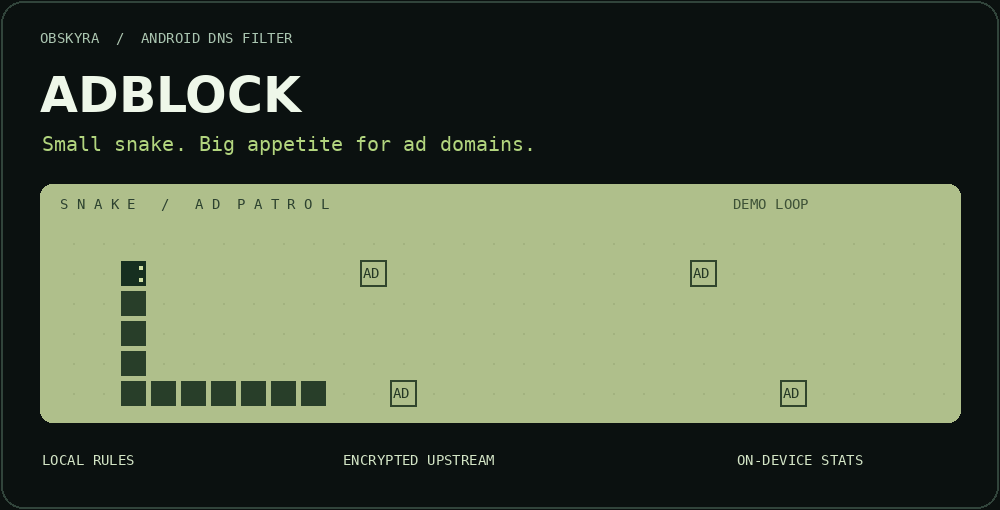
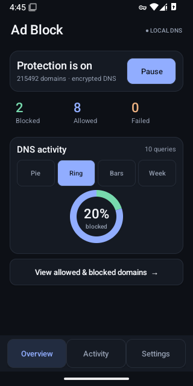
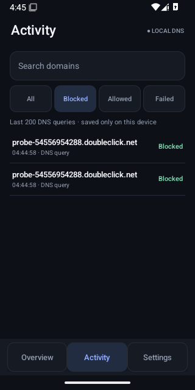
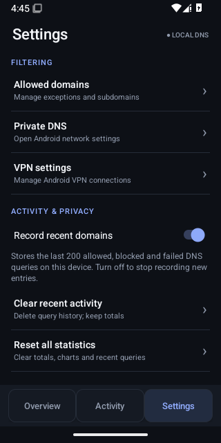
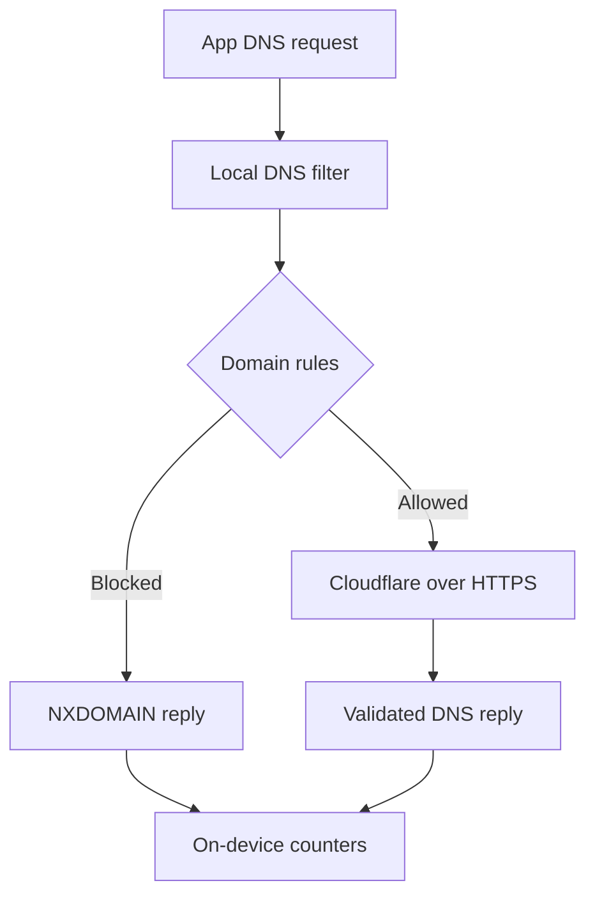

<p align="center">

**Experimental VPN branch:** WireGuard and OpenVPN engines now run inside AdBlock's
single Android VPN service. Import profiles from **☰ → Import VPN Profile**, select
one under **VPN Connections**, then connect. DNS blocking can be switched off
independently. This branch is undergoing endpoint/device verification; see
[STATUS](docs/STATUS.md) and [VPN verification](docs/VERIFICATION.md). It is not a
production release. Existing DNS-only protection, 507,468 bundled rules, activity,
charts and allowlists are retained.

WireGuard: `.conf` with interface addresses, DNS, peers, endpoints and AllowedIPs.
OpenVPN: `.ovpn` with embedded PEM certificates, or a ZIP containing one `.ovpn`
and relative certificate files. Username/password and private-key password are
editable in profile settings. Scripts, external PKI, compression and insecure TLS
profiles are rejected. A VPN server/provider is required.

Remote failures retain captured routes while the service lives. For protection
against process death, configure Android Always-on VPN + Block connections without
VPN **only with a remote profile selected**. DNS-only mode cannot forward ordinary
traffic under Android lockdown. Private DNS/app-specific encrypted DNS can bypass
domain filtering even though captured traffic remains inside the remote tunnel.

  
</p>

<p align="center">
  <strong>AdBlock</strong><br />
  An Android adblocker with local filtering and a clear view of your DNS activity.
</p>

<p align="center">
  <a href="https://github.com/billyke2000s/Ultimate-ad-block/actions/workflows/system-block.yml"></a>
  
  
  
</p>

<p align="center">
  <a href="https://github.com/billyke2000s/Ultimate-ad-block/releases/tag/v0.4.0"><strong>Release & APK</strong></a>
  &nbsp; / &nbsp;
  <a href="docs/ARCHITECTURE.md">Architecture</a>
  &nbsp; / &nbsp;
  <a href="docs/VERIFICATION.md">Verification</a>
  &nbsp; / &nbsp;
  <a href="docs/STATUS.md">Current status</a>
</p>

---

## Feed the snake. Starve the ad domains.

The idea is simple: check a DNS request against local domain rules, refuse blocked names, and resolve allowed names over an authenticated HTTPS connection. Keep the controls understandable and the statistics on the device.

The snake above is a decorative animation, not a live dashboard or a measure of ads removed.

## The loadout

| Capability | What it does |
| :--- | :--- |
| **Local domain filtering** | Bundles 507,468 unique ad, tracker, pop-up and known-threat domain rules, with parent-domain matching. |
| **Encrypted upstream DNS** | Resolves allowed queries through certificate-verified Cloudflare DNS over HTTPS, with no plaintext fallback. |
| **Compact overview** | Fixed bottom navigation and four chart selectors that fit across the screen: pie, ring, bars and week. |
| **Visible domain activity** | Search the latest 200 DNS queries and filter by blocked, allowed or failed, with per-query times and an allow-domain action. |
| **Exceptions you control** | Allow a domain and its subdomains; restart protection to apply the change. |
| **On-device statistics** | Preserves totals, up to 200 blocked-domain counters, 90 daily entries and the newest 200 queries. Turn activity recording off or clear its history in Settings. |
| **Visible controls** | User-approved VPN consent, start/stop controls and a foreground notification with Stop. |

**The counters measure DNS queries.** They do not measure individual ads, per-app activity or bandwidth saved.

## Inside the app

<p align="center">
  
  &nbsp;
  
  &nbsp;
  
</p>

<p align="center"><sub>Actual v0.4.0 Android 15 emulator captures. Queries are synthetic test traffic.</sub></p>

Activity history began in v0.4.0; older totals do not contain past allowed-domain names. Recent activity is stored locally and can be disabled or cleared independently of the totals.

## Bundled rules

The v0.5.0 bundle contains **507,468 unique domain rules**, compared with 215,492 previously. It combines StevenBlack unified hosts with HaGeZi Multi PRO, Pop-Up Ads and TIF Medium, then removes duplicates and redundant subdomain rules. The additional coverage includes known malware and phishing domains as well as ads and trackers. Exceptions remain available in Settings.

The compressed bundle belongs to this app and loads offline. [Source versions, counts and hashes](systemblock/src/main/assets/blocklist-sources.json) record exactly what was included. Run `bash scripts/update-blocklist.sh` to refresh it, then `python3 scripts/check-blocklist.py` to validate it. Lists are refreshed for releases, rather than silently downloaded at app startup.

## Under the pixels



Android's local VPN API directs the virtual resolver's `10.111.0.2/32` route into the filter. Ordinary internet traffic goes directly to its destination. Allowed lookups use Cloudflare `1.1.1.1`, with `1.0.0.1` as a bootstrap fallback, authenticated for `cloudflare-dns.com`.

The upstream resolver can see allowed DNS queries. No analytics or query-history upload backend is implemented. See [privacy and security](docs/PRIVACY_SECURITY.md) for data handling and trust boundaries.

## Proof, with boundaries

| Area | Evidence |
| :--- | :--- |
| Build, unit tests and lint | [Successful v0.4.0 workflow](https://github.com/billyke2000s/Ultimate-ad-block/actions/runs/41579642400); 19 unit tests; lint: 0 errors, 8 warnings. |
| Cross-app DNS and ordinary connectivity | Exercised by a separate probe app on Android 8 / API 26 and Android 15 / API 35 emulators. |
| Service lifecycle | Named start/stop cases exercised in emulator CI. |
| Charts | Overview visibility, four selectors, activity filters and search exercised in emulator CI; actual captures inspected. Full accessibility and physical-device review remains pending. |
| Physical devices | Full runtime test matrix remains pending; see the status document for device reports. |
| Distribution | Debug-signed testing prerelease; stable production signing and update compatibility remain pending. |

Source for the published APK: [`ef5adc0`](https://github.com/billyke2000s/Ultimate-ad-block/commit/ef5adc05b06dd742559c05ea0f7cb9699efb04b8). Detailed evidence and remaining work live in [STATUS](docs/STATUS.md).

## Know the edges

- **One VPN slot.** This occupies Android's VPN slot and cannot run alongside another VPN in the same profile. The AdBlock-only mode does not provide a remote privacy tunnel; the experimental remote modes integrate their own engines.
- **Domain filtering has limits.** Same-domain ads, including many YouTube ads, cannot be removed this way. There is no HTTPS interception or cosmetic filtering.
- **Bypasses exist.** Android Private DNS, an app's own encrypted DNS, explicit network selection, hard-coded IPs and cached answers can bypass the filter.
- **Client TCP DNS is pending.** Oversized UDP replies signal truncation; clients needing TCP may fail.
- **Lockdown is unsupported.** Do not enable Android's “Block connections without VPN” setting in AdBlock-only mode.
- **Persistence is buffered.** Abrupt process death may lose recent statistics. A differently signed update may not install over an older build; uninstalling erases local settings and counters.

## Build it

Use **Java 17 · Android SDK 35 · Gradle 8.9**.

```sh
gradle :systemblock:testDebugUnitTest :systemblock:assembleDebug :systemblock:lintDebug
```

APK output: `systemblock/build/outputs/apk/debug/systemblock-debug.apk`.

The installed application ID is `com.obskyra.systemwideblockbrowser`; Android 8.0 / API 26 is the minimum. For the device matrix and reproducible checks, read [VERIFICATION](docs/VERIFICATION.md).

## A repository you can navigate

| Path | Purpose |
| :--- | :--- |
| [`systemblock/`](systemblock/) | The independent DNS blocker, dashboard and tests. |
| [`dnsprobe/`](dnsprobe/) | CI-only app for cross-app DNS and connectivity checks; excluded from the published blocker APK. |
| [`docs/ARCHITECTURE.md`](docs/ARCHITECTURE.md) | Data flow, entry points and lifecycle ownership. |
| [`docs/STATUS.md`](docs/STATUS.md) | Implemented, verified and outstanding work. |
| [`AGENTS.md`](AGENTS.md) | Contributor and AI-agent rules; start here before changing code. |

## Credits & care

The bundled domain list retains attribution to **StevenBlack hosts (MIT)** and **HaGeZi Multi PRO, Pop-Up Ads and Threat Intelligence Feeds Medium (GPL-3.0)**. Applicable notices and licence texts are included in [APK assets](systemblock/src/main/assets/licenses/); see [dependencies](docs/DEPENDENCIES.md).

The Snake-inspired banner is original repository artwork, built with Pillow. It is a nod to the monochrome phone era, with no affiliation to Nokia. [Animation source](docs/assets/render-ad-patrol.py).

---

<p align="center">
  <strong>Less noise. More signal.</strong><br />
  <sub>Built by Obskyra · Local rules. Clear boundaries. Evidence before claims.</sub>
</p>
