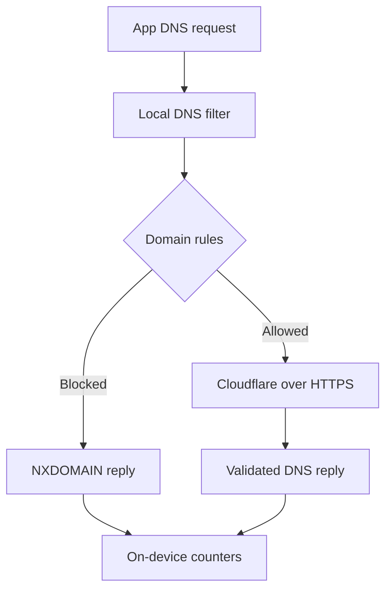

<p align="center">
  
</p>

<p align="center">
  <strong>System Wide Block Browser</strong><br />
  A small Android DNS filter with an appetite for ad and tracker domains.
</p>

<p align="center">
  <a href="https://github.com/billyke2000s/Ultimate-ad-block/actions/workflows/system-block.yml"></a>
  
  
  
</p>

<p align="center">
  <a href="https://github.com/billyke2000s/Ultimate-ad-block/releases/tag/v0.2.0"><strong>Release & APK</strong></a>
  &nbsp; / &nbsp;
  <a href="docs/ARCHITECTURE.md">Architecture</a>
  &nbsp; / &nbsp;
  <a href="docs/VERIFICATION.md">Verification</a>
  &nbsp; / &nbsp;
  <a href="docs/STATUS.md">Current status</a>
</p>

---

## Feed the snake. Starve the ad domains.

The idea is simple: check a DNS request against local domain rules, refuse blocked names, and resolve allowed names over an authenticated HTTPS connection. Keep the controls understandable and the statistics on the device.

Built from the domain list used by [Blockbrowser](https://github.com/billyke2000s/Blockbrowser), this is a separate Android app. The snake above is a decorative animation, not a live dashboard or a measure of ads removed.

## The loadout

| Capability | What it does |
| :--- | :--- |
| **Local domain filtering** | Bundles 215,000+ ad and tracker domain rules, with parent-domain matching. |
| **Encrypted upstream DNS** | Resolves allowed queries through certificate-verified Cloudflare DNS over HTTPS, with no plaintext fallback. |
| **Four views of activity** | Pie, doughnut, top-domain bars and a seven-day activity line. |
| **Exceptions you control** | Allow a domain and its subdomains; restart protection to apply the change. |
| **On-device statistics** | Saves query totals locally, with up to 200 domain entries and 90 days of daily history. |
| **Visible controls** | User-approved VPN consent, start/stop controls and a foreground notification with Stop. |

**The counters measure DNS queries.** They do not measure individual ads, per-app activity or bandwidth saved.

## Under the pixels



Android's local VPN API directs the virtual resolver's `10.111.0.2/32` route into the filter. Ordinary internet traffic goes directly to its destination. Allowed lookups use Cloudflare `1.1.1.1`, with `1.0.0.1` as a bootstrap fallback, authenticated for `cloudflare-dns.com`.

The upstream resolver can see allowed DNS queries. No analytics or query-history upload backend is implemented. See [privacy and security](docs/PRIVACY_SECURITY.md) for data handling and trust boundaries.

## Proof, with boundaries

| Area | Evidence |
| :--- | :--- |
| Build, unit tests and lint | [Successful v0.2.0 workflow](https://github.com/billyke2000s/Ultimate-ad-block/actions/runs/41549297575); 15 unit tests; lint: 0 errors, 6 warnings. |
| Cross-app DNS and ordinary connectivity | Exercised by a separate probe app on Android 8 / API 26 and Android 15 / API 35 emulators. |
| Service lifecycle | Named start/stop cases exercised in emulator CI. |
| Charts | Implemented; basic dashboard/pie rendering inspected. Full visual and accessibility review remains pending. |
| Physical devices | Full runtime test matrix remains pending; see the status document for device reports. |
| Distribution | Debug-signed testing prerelease; stable production signing and update compatibility remain pending. |

Source for the published APK: [`042ab7a`](https://github.com/billyke2000s/Ultimate-ad-block/commit/042ab7a5d9dbd29b82bc452fb2a50252d3b362a9). Detailed evidence and remaining work live in [STATUS](docs/STATUS.md).

## Know the edges

- **One VPN slot.** This occupies Android's VPN slot and cannot run alongside another VPN in the same profile. It does not provide a remote privacy tunnel.
- **Domain filtering has limits.** Same-domain ads, including many YouTube ads, cannot be removed this way. There is no HTTPS interception or cosmetic filtering.
- **Bypasses exist.** Android Private DNS, an app's own encrypted DNS, explicit network selection, hard-coded IPs and cached answers can bypass the filter.
- **Client TCP DNS is pending.** Oversized UDP replies signal truncation; clients needing TCP may fail.
- **Lockdown is unsupported.** Do not enable Android's “Block connections without VPN” setting for this DNS-only design.
- **Persistence is buffered.** Abrupt process death may lose recent statistics. A differently signed update may not install over an older build; uninstalling erases local settings and counters.

## Build it

Use **Java 17 · Android SDK 35 · Gradle 8.9**.

```sh
gradle :systemblock:testDebugUnitTest :systemblock:assembleDebug :systemblock:lintDebug
```

APK output: `systemblock/build/outputs/apk/debug/systemblock-debug.apk`.

The installed application ID is `com.obskyra.systemwideblockbrowser`; Android 8.0 / API 26 is the minimum. For the device matrix and reproducible checks, read [VERIFICATION](docs/VERIFICATION.md).

## A repository you can navigate

| Path | Purpose |
| :--- | :--- |
| [`systemblock/`](systemblock/) | The independent DNS blocker, dashboard and tests. |
| [`dnsprobe/`](dnsprobe/) | CI-only app for cross-app DNS and connectivity checks; excluded from the published blocker APK. |
| [`app/`](app/) | Preserved original browser source and shared domain-list asset. |
| [`docs/ARCHITECTURE.md`](docs/ARCHITECTURE.md) | Data flow, entry points and lifecycle ownership. |
| [`docs/STATUS.md`](docs/STATUS.md) | Implemented, verified and outstanding work. |
| [`AGENTS.md`](AGENTS.md) | Contributor and AI-agent rules; start here before changing code. |

Inherited browser screenshots and the older browser tour describe Blockbrowser, not this app's current interface.

## Credits & care

The bundled domain list retains attribution to **StevenBlack hosts (MIT)** and **HaGeZi Multi PRO (GPL-3.0)**. Applicable notices and licence texts are included in [APK assets](systemblock/src/main/assets/licenses/); see [dependencies](docs/DEPENDENCIES.md).

The Snake-inspired banner is original repository artwork, built with Pillow. It is a nod to the monochrome phone era, with no affiliation to Nokia. [Animation source](docs/assets/render-ad-patrol.py).

---

<p align="center">
  <strong>Less noise. More signal.</strong><br />
  <sub>Built by Obskyra · Local rules. Clear boundaries. Evidence before claims.</sub>
</p>
